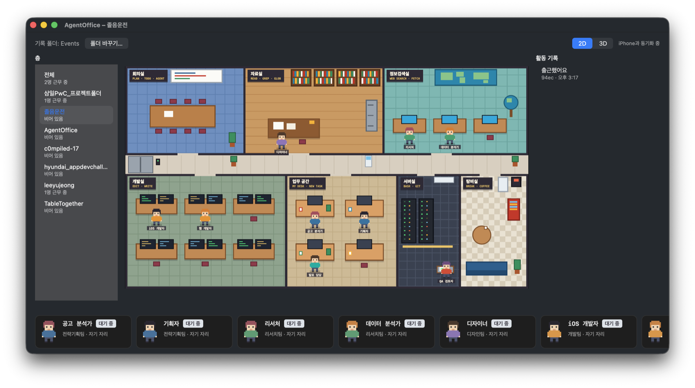
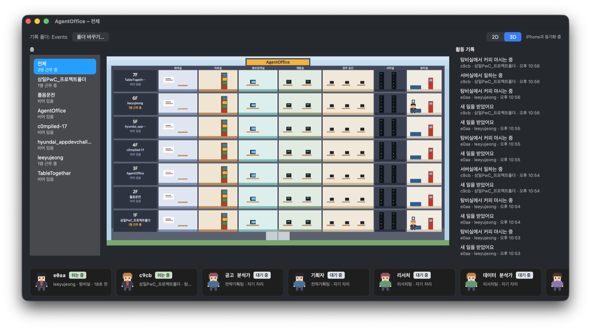
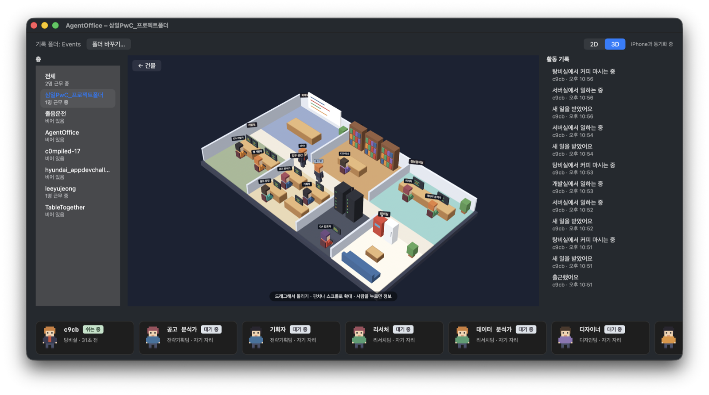

# AgentOffice

**See your Claude Code sessions at work, as a pixel-art office on your Mac and iPhone.**

Every coding session becomes an employee. Every tool call sends them to a room.
When a session needs your approval, its employee raises a hand, so you can tell at a glance
who is working, who is waiting for you and who is done.

| 2D floor plan | 3D building | 3D floor |
|---|---|---|
|  |  |  |

> AgentOffice is an independent project. It is not made by, affiliated with or endorsed by Anthropic.

## Features

- **One floor per project.** Sessions are grouped by the folder they run in. The floor list shows who is at work on each.
- **Rooms follow the work.** Employees walk to the room for the tool they are using, around the furniture.

  | Room | Tools |
  |---|---|
  | Archive | Read, Grep, Glob |
  | Dev room | Edit, Write |
  | Server room | Bash |
  | Research room | WebSearch, WebFetch |
  | Meeting room | Planning, to-do lists, starting subagents |
  | Break room | Resting after a reply |
  | Workspace | Everything else |

- **Status at a glance.** A tag over each head shows *working*, *waiting for you* or *resting*. Employees waiting for approval raise a hand.
- **A resident team.** Custom subagents sit at their own desks in department uniforms. When they get work, the same character walks to the briefing, then to the work, and back.
- **2D or 3D.** Switch between a top-down floor plan and a building in cutaway. Tap a floor to open it in 3D, then drag to turn and pinch to zoom.
- **iPhone companion.** The Mac sends a small summary to your private iCloud database, and the iPhone app shows the same office. It tells you when the Mac is offline.
- **Follows your folders.** Renaming a project folder renames its floor. Deleting it closes the floor.
- **English and Korean.**

## How it works

```
Claude Code ──hook──▶ JSON Lines files ──▶ Mac app ──CloudKit (summary only)──▶ iPhone app
```

1. A Claude Code [hook](https://docs.claude.com/en/docs/claude-code/hooks) runs [`Hooks/agentoffice-event.sh`](Hooks/agentoffice-event.sh) on each event and appends one line per event to a file for that session.
2. The Mac app reads that folder, works out where each session is and what it is doing, and draws the office.
3. The Mac app uploads a summary of each employee to your **private** CloudKit database.
4. The iPhone app reads that summary and draws the same office. It is view only.

## Privacy

AgentOffice is built to show *what kind of work* is happening, never the work itself.

- The hook records only an allow-list of fields: event name, session ID, tool name, subagent type, the project **folder name** and the time.
- Prompts, tool inputs, command text, file contents and full paths are **never** recorded.
- Event files stay on your Mac, readable only by you (`600`).
- iCloud receives only each employee's name, floor, room, status, role and last activity time, in your private database.
- The Mac app runs in the App Sandbox and reads only the folder you choose.
- The iPhone app cannot send anything back to your Mac.

## Requirements

- macOS 26 and iOS 26
- Xcode 26
- [Claude Code](https://docs.claude.com/en/docs/claude-code/overview)
- [`jq`](https://jqlang.org) (`brew install jq`)
- An Apple Developer account to sign the apps, for iCloud sync

## Getting started

A signed download is on the way. Until then, build it from source.

1. **Clone the repository.**
   ```sh
   git clone https://github.com/YUJEONGLEEEEE/AgentOffice.git
   ```
2. **Connect the hook.** Add this to `~/.claude/settings.json`, with the path to your clone. Use the same entry for `SessionStart`, `SessionEnd`, `UserPromptSubmit`, `PreToolUse`, `SubagentStart`, `SubagentStop`, `Notification` and `Stop`.
   ```json
   {
     "hooks": {
       "PreToolUse": [
         {
           "matcher": "*",
           "hooks": [
             { "type": "command", "command": "\"/path/to/AgentOffice/Hooks/agentoffice-event.sh\"", "timeout": 5 }
           ]
         }
       ]
     }
   }
   ```
   Claude Code reads hooks when a session starts, so restart any open sessions.
3. **Run the Mac app.** Open `AgentOffice.xcodeproj`, choose your team under *Signing & Capabilities* for both targets, and run the **AgentOfficeMac** scheme.
4. **Choose the events folder** when the app asks: `~/Library/Application Support/AgentOffice/Events`.
5. **Optional: run the iPhone app** with the **AgentOffice** scheme, signed in to the same iCloud account.

## Project structure

| Folder | What it is |
|---|---|
| `AgentOfficeKit/` | Swift package shared by both apps: event and session models, room rules, the 2D office (SpriteKit), the building and the 3D floor (RealityKit), CloudKit sync |
| `AgentOfficeMac/` | Mac app (AppKit). Reads the events folder and publishes the summary |
| `AgentOffice/` | iPhone app (UIKit). Shows the office from iCloud |
| `Hooks/` | The Claude Code hook script |

Built with Swift 6, AppKit, UIKit, SpriteKit, RealityKit, SwiftUI, CloudKit and Swift Testing. Routes around furniture use A\* search on a walking grid.

## Tests

```sh
cd AgentOfficeKit
swift test
```

## Roadmap

- [ ] Signed and notarized Mac download on GitHub Releases
- [ ] A setup guide in the app that installs the hook for you
- [ ] A demo mode that runs without Claude Code
- [ ] A notification when an employee is waiting for your approval
- [ ] iPhone app on the App Store

## License

[MIT](LICENSE)
